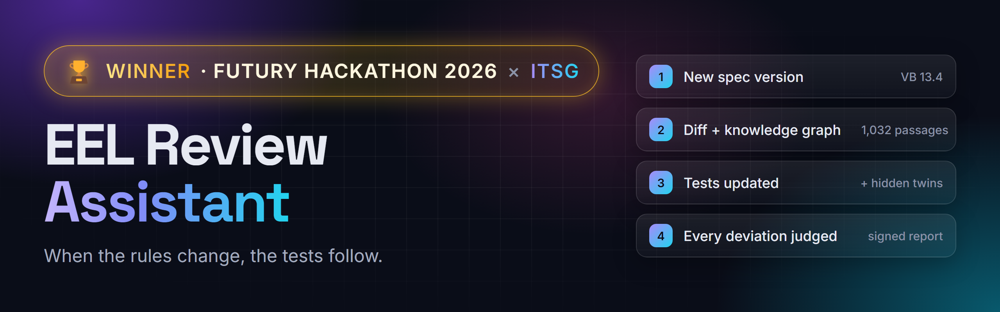
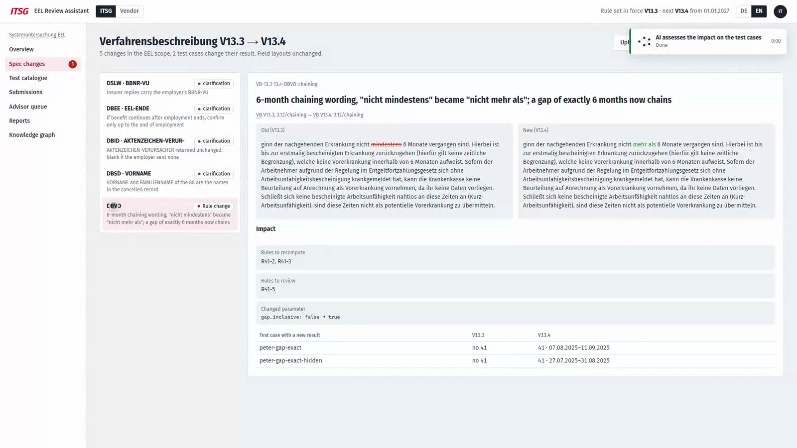
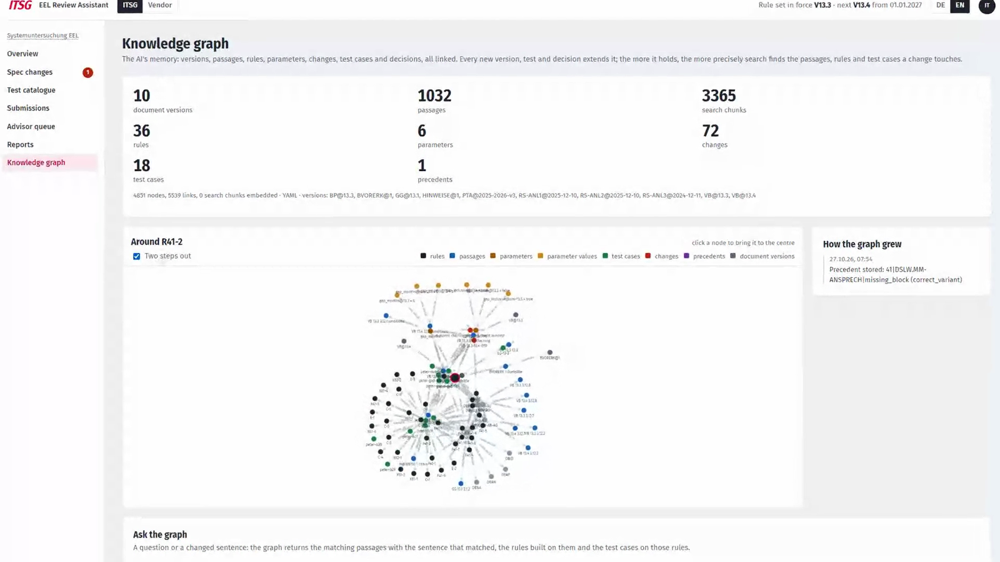
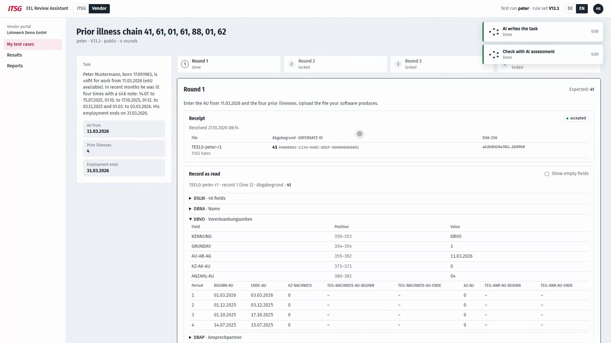
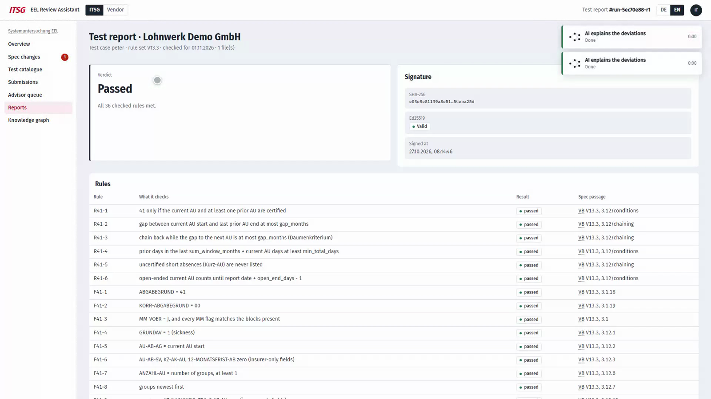
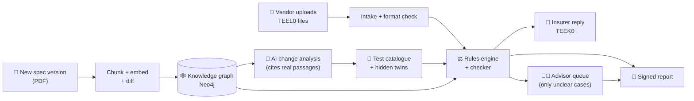

<p align="center">
  
</p>

<p align="center">
  
  <br>
  
  
  
  
  
  
</p>

<p align="center">
  <b>An AI test platform for German payroll software certification.</b><br>
  Upload a new version of the rules, and the EEL Review Assistant finds what changed, updates the tests and judges every vendor result, with a signed report.
</p>

<p align="center">
  <a href="#-the-problem">Problem</a> ·
  <a href="#-what-the-eel-review-assistant-does">Solution</a> ·
  <a href="#-see-it-in-action">Demo</a> ·
  <a href="#-how-it-works">How it works</a> ·
  <a href="#-run-it-yourself">Run it</a> ·
  <a href="#-team">Team</a>
</p>

<p align="center">
  
</p>

---

## 🧩 The problem

Payroll software (SAP, DATEV, Lexware, …) must be certified by **ITSG** before it may send data to the German social insurers. For income replacement benefits (**EEL**, *Entgeltersatzleistungen*) that means:

- **800 million messages a year**, from about **100 payroll programs**, with one goal: zero errors.
- **Hundreds of pages of rules** (Verfahrensbeschreibung, Beispielpapier, Rundschreiben) that **change every year**.
- A certification exam with **only 2 hand-written test employees** for EEL, so vendors can learn them.
- **One fixed solution** per test: a correct alternative still shows up as a deviation, and an ITSG advisor has to sort each one out by hand.

## 🚀 What the EEL Review Assistant does

> **One platform for EEL testing: it receives the files, answers like the insurer, judges every difference and keeps the tests up to date.**

| | Feature | What it means |
|---|---|---|
| 📄 | **Spec diff** | Upload a new spec version. It compares it with the old one and finds the changes that matter, down to a single phrase. |
| 🕸️ | **Knowledge graph** | Every rule, passage, field layout, parameter and test case is linked. A change shows directly which rules and tests it affects. |
| 🧪 | **Test builder** | Builds new test cases around rule boundaries, plus a **hidden twin** per test: same rule, different data, never shown to the vendor. |
| 📥 | **Intake + insurer simulator** | Vendors upload their files, get a receipt and a format check, and receive the insurer's reply so the story continues month by month. |
| ⚖️ | **Checker** | Exact match first, then every deviation gets a label: *correct variant*, *bug*, *invalid* or *unclear*, each citing the spec passage. |
| 🧑‍⚖️ | **Advisor queue** | Only *unclear* cases reach a human, with an AI proposal and past decisions (precedents) next to them. |
| 🔏 | **Signed report** | The final verdict, signed with SHA-256 + Ed25519, so anyone can verify it was not changed. |

**The demo case:** from V13.3 to V13.4 of the Verfahrensbeschreibung, one phrase flips: *"nicht mindestens"* → *"nicht mehr als"*. A gap of exactly 6 months between two illnesses now counts as chained. The assistant spots it, marks the affected rules, recomputes the expected results and flags the two test cases whose outcome changes.

## 🎬 See it in action

<table>
  <tr>
    <td width="50%"><br><b>Spec changes.</b> V13.3 → V13.4, the phrase that flipped, the rules and tests it touches.</td>
    <td width="50%"><br><b>Knowledge graph.</b> 1,032 passages, 36 rules, 18 test cases, all linked.</td>
  </tr>
  <tr>
    <td width="50%"><br><b>Vendor view.</b> Upload a file, get a receipt, every rule checked, the insurer replies.</td>
    <td width="50%"><br><b>Signed report.</b> Verdict, each rule with its spec passage, Ed25519 signature.</td>
  </tr>
</table>

The UI is in **German by default** with an English switch. Legal terms, field names and spec passages always stay German, so the meaning of the law never changes in translation.

## ⚙️ How it works



**Design rule:** calculations never come from the AI. The rules engine computes every expected value. The AI only proposes and explains, and code validates each answer: citations must be real passage keys, and parameter names and types are checked.

| Layer | Where | Tech |
|---|---|---|
| UI | [`ui/`](ui/) | React, TypeScript, Vite, i18n DE/EN |
| API | [`api/`](api/) | FastAPI |
| Engine | [`engine/`](engine/) | fixed-width record parser/writer, rules, checker, spec diff, Ed25519 signing |
| Knowledge graph | [`kg/`](kg/) | Neo4j (or a YAML backend with no database) |
| AI | [`llm/`](llm/) | OpenAI Structured Outputs, answers cached |
| Store | [`store/`](store/) | PostgreSQL (or in memory) |

## 🏃 Run it yourself

**Fastest way (no Docker, no API key):** in-memory store and the YAML knowledge base.

```bash
uv sync
DATABASE_URL= uv run uvicorn api.main:app --port 8000    # terminal 1
cd ui && npm install && npm run dev                      # terminal 2 → http://127.0.0.1:5173
```

**Full setup** (Postgres + Neo4j + real AI calls):

```bash
cp .env.example .env                                      # add OPENAI_API_KEY, NEO4J_PASSWORD
docker compose up -d postgres neo4j
SPEC_BASELINE=VB@13.3 uv run python -m kg.build --skip-extract --fresh
SPEC_BASELINE=VB@13.3 SEED_ON_START=0 uv run uvicorn api.main:app --port 8000
cd ui && npm run dev
```

Then open **Spec changes** and upload V13.4 to watch the whole flow. Run the tests with `uv run pytest -q`.

More detail: [`ui/README.md`](ui/README.md) (running the UI), [`docs/HANDOUT.md`](docs/HANDOUT.md) (architecture and state), [`docs/SPEC_UPDATE_WORKFLOW.md`](docs/SPEC_UPDATE_WORKFLOW.md) (the core flow), [`docs/VM_DEPLOYMENT.md`](docs/VM_DEPLOYMENT.md) (deployment).

<details>
<summary><b>Knowledge graph build details</b></summary>

Built per [`plan/08_KG_SEEDING_GUIDE.md`](plan/08_KG_SEEDING_GUIDE.md). Needs `uv`, poppler (`pdftotext`) and, for the graph backend, Neo4j 5.13+.

```bash
uv run python -m kg.build                 # extract -> build -> validate -> load -> embed
uv run python -m kg.build --skip-load     # offline: passages + graph.json + validation only
uv run pytest tests/test_kg.py            # both backends; graph tests skip without Neo4j
```

`KG_BACKEND=yaml` (default) answers from `kg/seed/`, `layouts/` and `kg/build/passages.yaml` without Neo4j or OpenAI.
`KG_BACKEND=graph` uses Neo4j. Without `OPENAI_API_KEY` the embed step is skipped and search uses the full-text index.

</details>

<details>
<summary><b>Project docs</b></summary>

Start with [`plan/00_PROJECT_OVERVIEW.md`](plan/00_PROJECT_OVERVIEW.md).

| File | Topic |
|---|---|
| [`plan/01_DIAGRAMS.md`](plan/01_DIAGRAMS.md) | diagrams |
| [`plan/03_DOMAIN_RULES_VORERKRANKUNG.md`](plan/03_DOMAIN_RULES_VORERKRANKUNG.md) | prior-illness rules |
| [`plan/04_SPEC_DIFF_13.3_TO_13.4.md`](plan/04_SPEC_DIFF_13.3_TO_13.4.md) | what changed from V13.3 to V13.4 |
| [`plan/05_CHECKING_AND_DEVIATIONS.md`](plan/05_CHECKING_AND_DEVIATIONS.md) | how deviations are judged |
| [`plan/06_LIFECYCLE_AND_HIDDEN_TESTS.md`](plan/06_LIFECYCLE_AND_HIDDEN_TESTS.md) | test lifecycle and hidden twins |
| [`plan/07_KNOWLEDGE_GRAPH.md`](plan/07_KNOWLEDGE_GRAPH.md) | knowledge graph model |
| [`plan/09_TECH_STACK.md`](plan/09_TECH_STACK.md) | tech stack |

</details>

## 🔭 What's next

The engine doesn't depend on one procedure: record layouts and rules are data. Other procedures (DEÜV, contributions, …) can move over one by one, using the same platform.

## 👥 Team

Built at the **Futury Hackathon 2026 × ITSG**.

<p align="center">
  <b>Slim </b> · <b>Ahlem</b> · <b>Mohamed</b> · <b>Ghassen</b> 
</p>

---

<p align="center">
  <sub>A hackathon prototype. Not an official ITSG product. The rule documents belong to their publishers.</sub>
</p>
