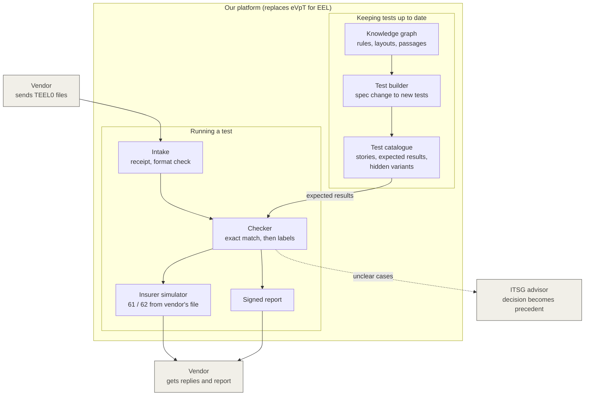

# System overview: one platform that replaces eVpT for EEL

Purple: built by us. Gray: outside the platform.
Assumed, not built: transmission network (GKV communication server), encryption, test company numbers.
Not drawn: ITSG approves new tests before they enter the catalogue; the knowledge graph also gives the checker its rules and spec passages.
Future (not in prototype): the vendor runs the checker locally before uploading.
