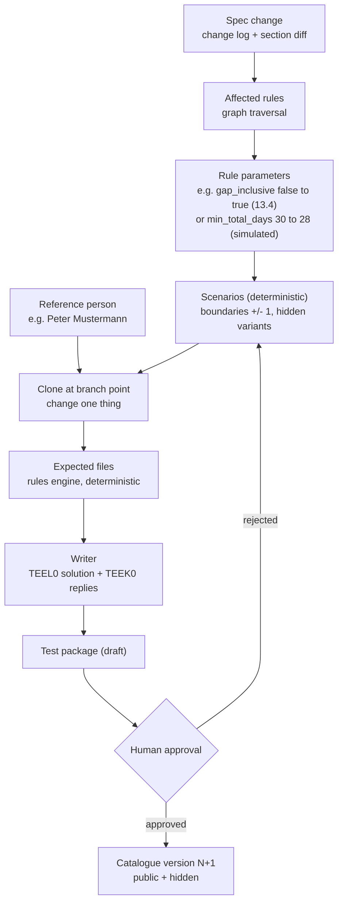

# Test builder flow

The spec-update agent (M8.7) decides per change whether a test needs no change, an update or a new test, and drafts it. Expected values always come from the rules engine through a tool call, never from the model. Scenarios come from the builder (M5.4, M5.6); the LLM writes the story text (M8.2) and drafts rules from passages (M8.3). Everything stays a draft until human approval.
