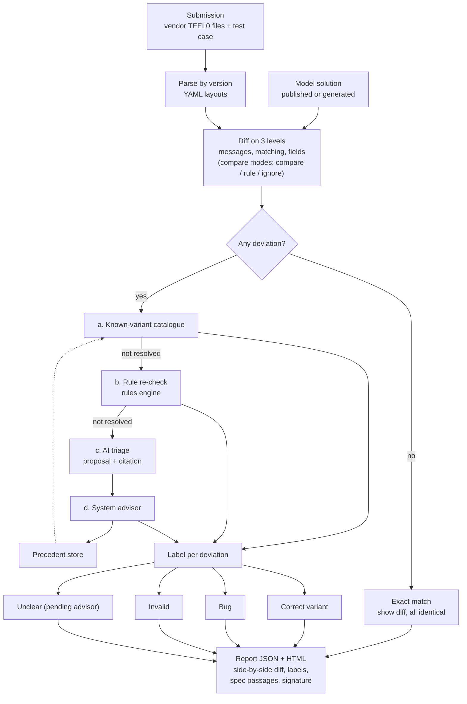

# Rule checker flow: exact match first, then deviation analysis

Result per test case = worst label (invalid > bug > unclear > correct variant > exact match).
Details: `05_CHECKING_AND_DEVIATIONS.md`.
