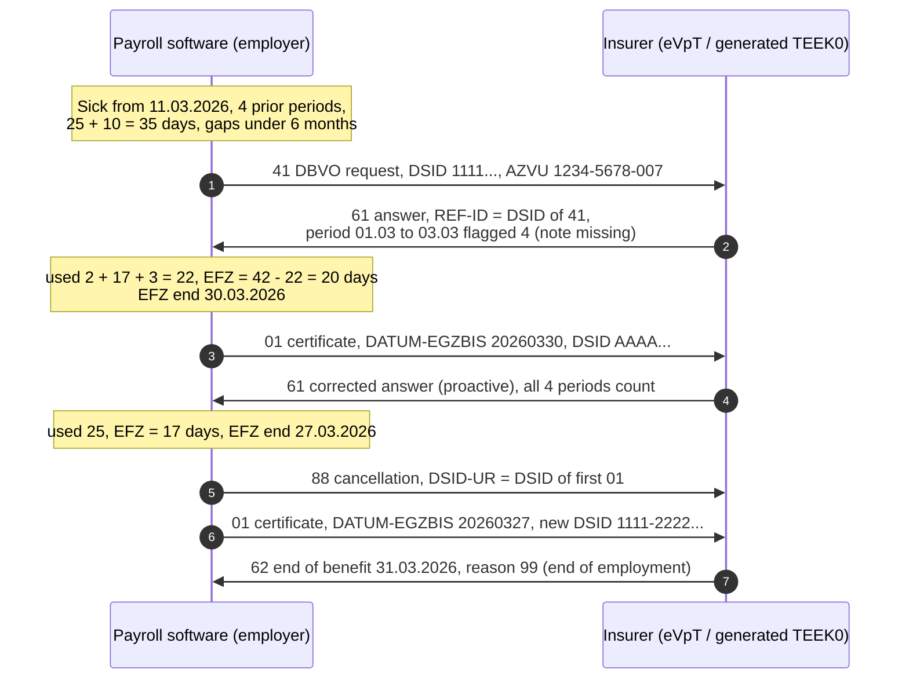

# Vorerkrankung test: expected message chain (Peter Mustermann)

What the checker grades (employer messages 1, 3, 6, 7):

| Step | Checks |
|---|---|
| 1 (41) | ITSG criteria f41c7278, 0cefe80e, aade0289, 9c8c9b58 + format of DBVO |
| 3 (01) | DATUM-EGZBIS = 30.03.2026, AZVU unchanged, new unique DSID |
| 6 (88) | DBSD.DATENSATZ-ID-URSPRUNGSMELDUNG = DSID of step 3 |
| 7 (01) | DATUM-EGZBIS = 27.03.2026, new unique DSID, AZVU unchanged |
