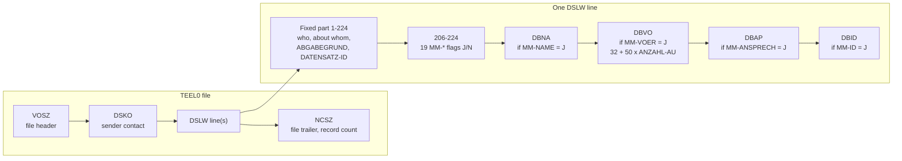

# Record structure of a DTA EEL file

Block order is fixed: DBNA, DBAN, DBAL, DBAE, DBZA, DBEE, DBAW, DBFR, DBUN, DBMU, DBVO, DBHE, DBBE, DBLT, DBSF, DBTK, DBAP, DBID, DBSD. Only blocks whose flag is J are present.

Blocks per message type in the prototype:

| Abgabegrund | Blocks |
|---|---|
| 41 prior-illness request | DBNA, DBVO, DBAP, DBID (ITSG file). Beispielpapier 13.1 also sets MM-ANSCHRIFT = J (DBAN) and MM-ID = N: mandatory blocks per Abgabegrund are in Anlage 3 of the VB, not available yet |
| 61 insurer answer | DBNA, DBVO, DBAP, DBID |
| 01 sickness benefit certificate | DBNA, DBAL, DBAE, DBAP, DBID |
| 88 cancellation | DBSD only (Beispielpapier 23) |
| 62 end of benefit | DBNA, DBEE, DBAP, DBID |
