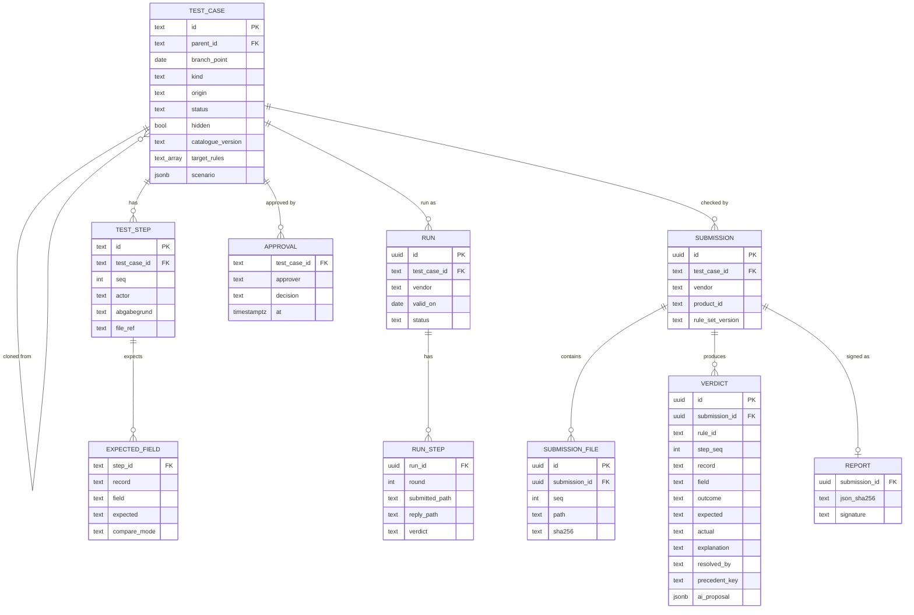

# Data model (Postgres on the team VM)

App data only. Spec versions, passages, rules, parameters, criteria and precedents live behind `kg/` (`07_KNOWLEDGE_GRAPH.md`); tables below reference them by key (`rule_id`, `precedent_key`).

`compare_mode`: compare, rule, ignore. `outcome` (per deviation): exact_match, correct_variant, bug, invalid, unclear. `kind`: reference, clone, hidden. `origin`: itsg, beispielpapier, builder. `status`: draft, approved, rejected. `resolved_by`: diff, catalogue, rules, ai_proposal, advisor. `precedent_key`: record + field + kind of deviation, the key of the precedent in `kg/`.
