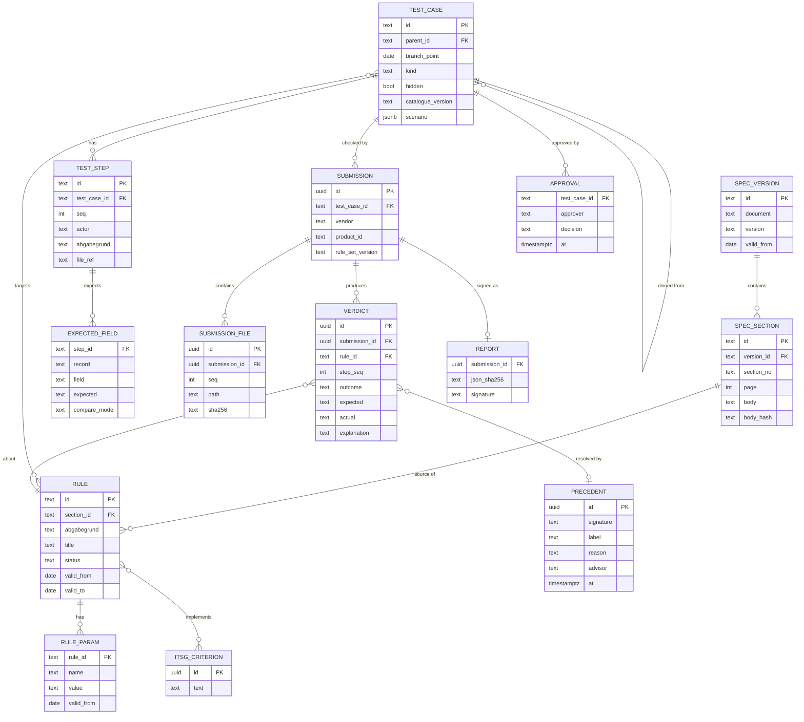

# Data model (Supabase Postgres)

`compare_mode`: compare, rule, ignore. `outcome` (per deviation): exact_match, correct_variant, bug, invalid, unclear. `kind`: reference, boundary, clone, hidden. `PRECEDENT.signature`: record + field + kind of deviation, used by the known-variant catalogue.
VERDICT also stores `resolved_by` (diff, catalogue, rules, ai_proposal, advisor) and `ai_proposal` (JSON).
