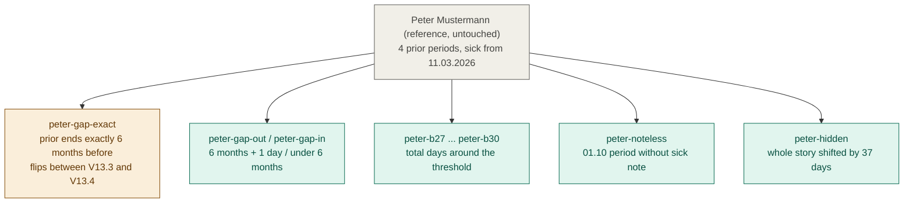

# Test case clones: reuse people, branch the timeline

Each clone copies the history up to a branch point, changes one thing, and gets its expected results recomputed by the rules engine. The original's expected results never change.

| Clone | V13.3 | V13.4 | Simulated V13.5 (28 days) |
|---|---|---|---|
| peter | 41 | 41 | 41 |
| **peter-gap-exact** | **no 41** | **41** | 41 |
| peter-gap-out | no 41 | no 41 | no 41 |
| peter-gap-in | 41 | 41 | 41 |
| peter-b28, peter-b29 | no 41 | no 41 | **41** |
| peter-b27 | no 41 | no 41 | no 41 |
| peter-b30 | 41 | 41 | 41 |
| peter-noteless | no 41 | no 41 | no 41 |
| peter-hidden | 41 | 41 | 41 |

Full definitions: `03_DOMAIN_RULES_VORERKRANKUNG.md`, section 9.
