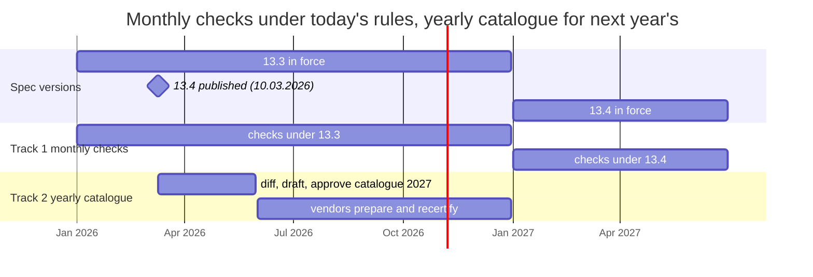

# Lifecycle: two tracks in parallel

| Event | Trigger | Output |
|---|---|---|
| A | new spec version published | new and changed tests for next year |
| B | before 1 January | recertification against next year's catalogue |
| C | every month | checks under today's rules + rotated hidden variants |
| D | new software, any time | full current catalogue + extended hidden checks |
